# Calendar 1.0

## Quick Start

> [!NOTE]
> Use the Calendar package that matches your Unreal Engine version. Calendar 1.0 supports Unreal Engine 5.4 to 5.8 on Windows. No C++ is needed for this setup.

1. **Install Calendar** for your Unreal Engine version using the Epic Games Launcher, or place the matching plugin folder in your project's `Plugins` folder before opening it.

2. **Enable Calendar** in **Edit > Plugins**, then restart Unreal if prompted.

   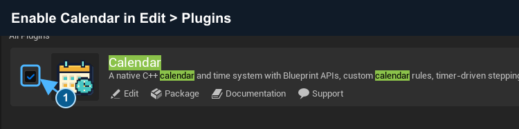

   *Calendar must be checked before continuing.*

3. **Open Calendar Editor** from **Window > Calendar Editor**.

4. **Click + New profile** and save it in your project's Content folder as `DA_MyCalendar`.

   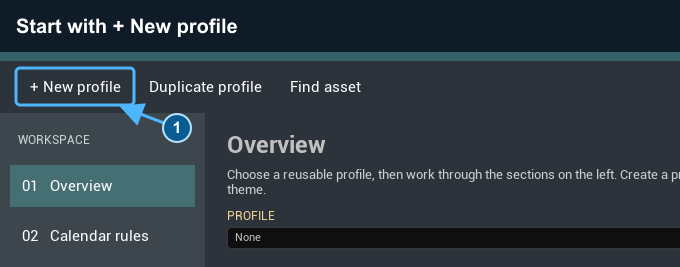

   *New profile creates your own profile, rules, and theme assets. The preview shows the starting date.*

5. **Select Time & behavior** in the left navigation.

6. **Set Auto Advance Unit to Day**.

7. **Check Start Auto Advance on Begin Play**. Keep **Initialize on Begin Play** checked, **Auto Advance Amount** at `1`, and **Auto Advance Interval Seconds** at `1`.

   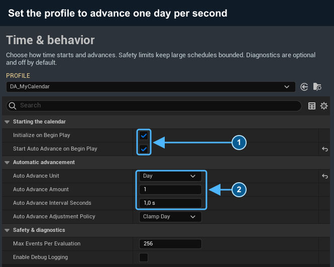

   *1: both start options are checked. 2: Day, amount 1, interval 1 second.*

8. **Click Save changes** to save the profile, rules, and theme.

9. **Create an Actor Blueprint** in your Content Browser: **Add > Blueprint Class > Actor**. Name it `BP_GameCalendar`.

10. **Add a Calendar Component** in that Blueprint's Components panel. Name it `GameCalendar`.

    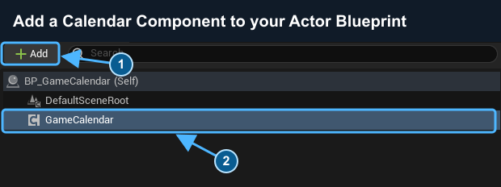

    *1: Add opens the component search. 2: GameCalendar is the component you added.*

11. **Assign DA_MyCalendar to Profile** on that component.

    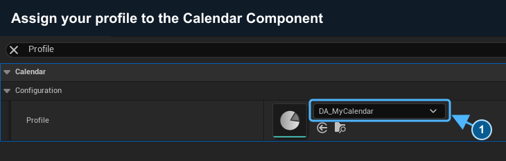

    *The profile supplies the component's rules and time settings when Play begins.*

12. **Drag GameCalendar from Components into the Event Graph** to get a reference to it.

13. **Drag from GameCalendar's blue output and add Get Profile**.

14. **Drag from Profile and add Create Calendar Widget**. Connect `GameCalendar` to its **Component** input.

15. **Drag from Create Calendar Widget's Return Value and add Add to Viewport**.

16. **Connect Event BeginPlay's white execution output to Add to Viewport**. **Create Calendar Widget** has no white execution pins; Unreal evaluates it when Add to Viewport needs the widget.

    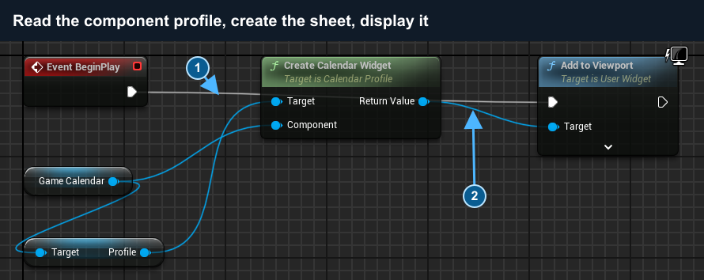

    *1: the white line connects BeginPlay directly to Add to Viewport. 2: the blue line supplies the widget. Profile reads the asset assigned in step 11.*

17. **Compile and save the Blueprint**.

18. **Place BP_GameCalendar in your own level** and save the level.

19. **Press Play**. The calendar sheet appears and its date advances once per game-time second. Stop Play before editing its setup.

    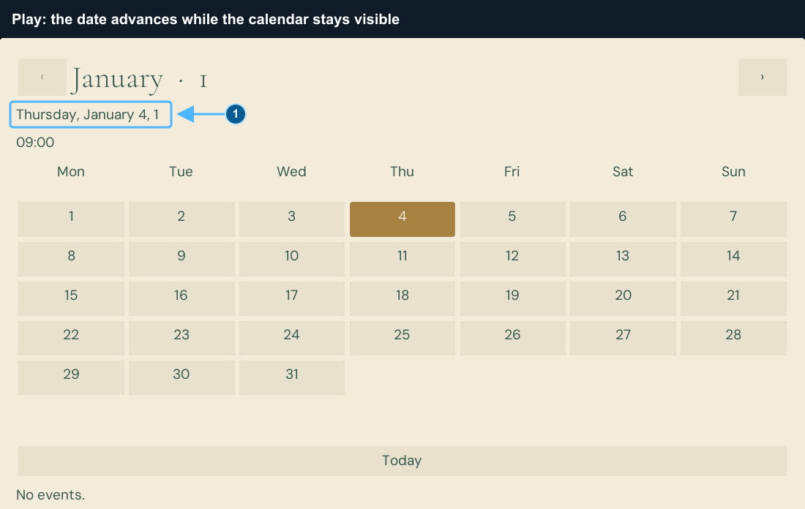

    *Success: the displayed date changes while Play runs. This capture uses 1 January, year 1 as its Start Date; yours uses the Start Date in Calendar rules. The editor's silent preview does not advance time.*

> [!TIP]
> Select any screenshot to inspect its controls at full size. For interactive browsing, set input mode and focus in your Player Controller as described in [Add player controls](#add-player-controls).

## Contents

- [Change your calendar setup](#change-your-calendar-setup)
- [Calendar rules](#calendar-rules)
- [Date operations](#date-operations)
- [Automatic time advancement](#automatic-time-advancement)
- [Calendar events](#calendar-events)
- [Save and restore](#save-and-restore)
- [Reusable calendar UI](#reusable-calendar-ui)
- [Authority and networking](#authority-and-networking)
- [Validation and troubleshooting](#validation-and-troubleshooting)
- [Advanced Blueprint reference](#advanced-blueprint-reference)
- [Support](#support)

## Change your calendar setup

Double-click a Calendar Profile, Calendar Definition, or Calendar Theme in the Content Browser to open it in the central editor. You can also create these asset types from the **Calendar** category in the Content Browser's Add menu.

The **Profile** dropdown includes three built-in examples: **DA_CivilProfile** (month grid), **DA_ValleyProfile** (week planner), and **DA_AstralProfile** (day list). The editor opens with Civil selected. Choosing **None** clears the preview.

Built-in profiles, rules, and themes are **read-only**. You can inspect every section. To customize an example:

1. Choose it in **Profile**.
2. Click **Duplicate profile** and save in your project's Content folder.
3. Edit your new profile. Its rules and theme are separate copies, so the built-in example stays unchanged.

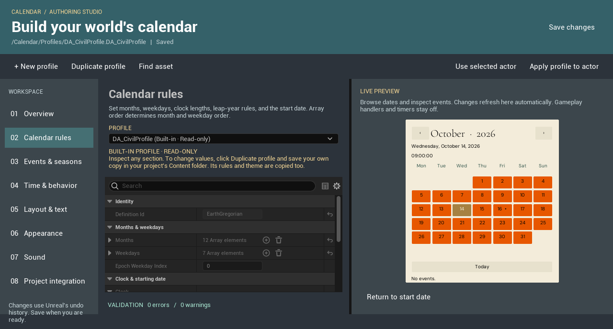

*Duplicate profile creates editable profile, rules, and theme assets for your project.*

| Section | What you can change |
| --- | --- |
| Overview | The profile's rules and theme assets |
| Calendar rules | Identity, ordered months and weekdays, clock lengths, leap adjustments, and starting date |
| Events & seasons | Categories, event names and descriptions, point/range dates, recurrence, seasonal labels, and handler classes |
| Time & behavior | BeginPlay setup, timer units/amount/interval, missing-day policy, event limits, and logging |
| Layout & text | Month grid, week planner, day list, date/time templates, era, week start, paging, and replacement widget classes |
| Appearance | Fonts, colors, textures/material brushes, button states, spacing, and sizes |
| Sound | Enable interface sounds for the profile and choose its theme's sound cues |
| Project integration | The selected actor's Calendar Component, including its normal replication setting |

**New profile** and **Duplicate profile** copy the selected setup into your project, including separate rules and theme assets. With **None** selected, **New profile** creates a small starting calendar. Rule copies get a new Definition ID so saves cannot silently cross between calendars. Keep the ID stable after shipping saved games. You can deliberately share a rules or theme asset by choosing the same asset in Overview; edits then affect every user of that asset.

Validation lists problems and the next step. Invalid rules hide the preview until fixed. The preview uses the native calendar sheet and native day cells, with sound, timers, and gameplay handlers off. Test replacement Blueprint widgets and sound cues in Play.

**Apply profile to actor** changes one selected level actor and supports Undo. It does not edit the actor's Blueprint class defaults. For reusable Actor Blueprints, add a Calendar Component and assign its **Profile** in the Blueprint's Details panel. Profiles are read before automatic BeginPlay initialization. They override the component's individual setup fields. Clear **Profile** to use those fields directly. Use **Use selected actor** to inspect an existing level setup.

Changes use Unreal's undo history. **Save changes** saves the current profile, rules, and theme; save level or Blueprint edits with their own Save command. Existing components without a profile continue to use their previous settings. Profile setup does not change existing snapshot formats or saved dates.

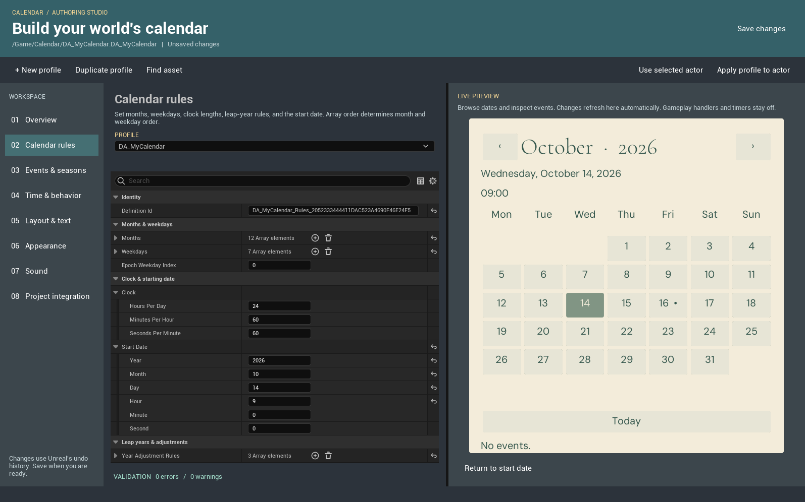

*Expand Months or Weekdays to edit their entries. The preview updates as you change valid rules.*

## Calendar rules

Create separate definition assets for calendars with different rules. Treat the assigned definition as fixed during a play session. After changing rules, validate them and initialize the component again.

| Setting | Meaning |
|---|---|
| Definition ID | Stable identity used by snapshots and diagnostics. Keep it unique and preserve it when updating an existing calendar. |
| Months | Ordered months. Each needs a unique ID and at least one day. The first entry is month `1`. |
| Weekdays | Ordered weekday cycle. Each needs a unique ID. Its entry count defines the length of a week. |
| Epoch Weekday Index | Zero-based weekday assigned to year `1`, month `1`, day `1`. It must reference a weekday entry. |
| Clock | Hours per day, minutes per hour, and seconds per minute. Each value must be at least `1`. |
| Start Date | Date used when initializing or resetting the component. It must fit the calendar rules. |
| Year Adjustment Rules | Add or remove days from a selected month in repeating years. |
| Event Categories | Ordered groups of scheduled event entries. |

Years, months, and days start at `1`. Hours, minutes, and seconds start at `0`. Dates before year `1` and values outside the definition's ranges are rejected.

Give each year-adjustment rule a unique **ID**, such as `LeapDay`. A rule uses **First Year**, **Interval Years**, **Month**, and a signed **Day Adjustment**. For example, first year `4`, interval `4`, month `2`, and adjustment `1` adds one day to month `2` every fourth year from year `4`. Several matching rules combine. Validate the definition after editing them; every resulting month must remain valid.

**Season ID** on a month is an optional label for your game. Calendar does not create weather or seasonal effects.

## Date operations

Use a reference to your actor's Calendar Component to call these nodes:

| Node | Use |
|---|---|
| Initialize Calendar | Validate the definition and copy its Start Date into the component. An optional replacement definition may be supplied. |
| Try Set Date | Set an exact valid destination date. Invalid values are rejected. |
| Try Advance | Move forward or backward by a signed number of seconds, minutes, hours, days, weeks, months, or years. |
| Try Step | Apply the configured automatic unit and amount once, without starting a timer. |
| Reset to Start Date | Return to the definition's Start Date. Event evaluation is off by default for this reset. |

Each returns a **Calendar Operation Result**. Break the result and check **Success** before using the new state. On failure, read **Message**, **Context**, and **Suggested Action**.

For month and year moves, choose the missing-day policy:

- **Clamp Day:** use the destination month's last day when the original day is missing.

- **Reject:** leave the date unchanged and return a failure.

For example, advancing from day `31` to a month with `30` days gives day `30` with Clamp Day. Reject keeps the original date. An amount of `0` is a successful no-op.

The component exposes **On Calendar Changed**, **On Day Changed**, **On Month Changed**, and **On Year Changed**. These Blueprint events notify your game when the corresponding date value changes. Bind them to update your UI or gameplay. A jump produces notifications for the committed change, not a notification for every intermediate date.

## Automatic time advancement

Automatic advancement uses a world timer. The Calendar Component does not need Tick.

| Setting | Default | Meaning |
|---|---:|---|
| Start Auto Advance on Begin Play | Off | Start the timer after successful automatic initialization. |
| Auto Advance Unit | Second | Calendar unit moved by each timer callback. |
| Auto Advance Amount | `1` | Signed non-zero number of units moved per callback. |
| Auto Advance Interval Seconds | `1` | Game-time interval between callbacks. It must be finite and at least `0.001` seconds. |
| Auto Advance Adjustment Policy | Clamp Day | Missing-day behavior for month and year moves. |

Use **Start Auto Advance** to start or resume, **Pause Auto Advance** to pause a running timer, and **Stop Auto Advance** to clear it. **Configure Auto Advance** changes the settings while the timer is stopped. Stop it before reconfiguring, then start it again.

For a seven-day step every `1.5` game-time seconds, stop the timer, call **Configure Auto Advance** with Unit `Day`, Amount `7`, and Interval Seconds `1.5`, check Success, then call **Start Auto Advance**. Use Unit `Week` when you want a step based on the number of weekdays in your definition.

You can also call **Try Step** once after changing the settings. This moves the date ahead immediately. **Start Auto Advance** then starts the repeating timer.

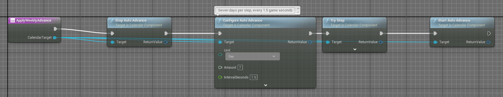

*Example custom Blueprint function: Stop Auto Advance > Configure Auto Advance (Day, 7, 1.5 seconds) > Try Step > Start Auto Advance. Check each operation's Success result before continuing in your game.*

The pictured **ApplyWeeklyAdvance** function is a custom example to create in your own Blueprint. The extra **Try Step** moves the date immediately; leaving it out starts with the timer's first callback. Break each returned Calendar Operation Result and continue only on **Success**.

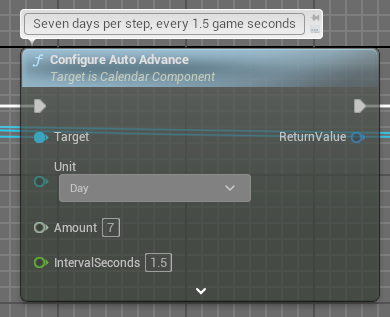

*Settings detail: Unit Day, Amount 7, Interval Seconds 1.5.*

**On Auto Advance State Changed** reports Stopped, Running, or Paused. World pause and time dilation affect this game-time timer. A failed automatic step stops the timer; fix the reported problem before restarting it.

## Calendar events

Add an **Event Category** with a unique ID to your definition, then add event entries. Each entry needs an ID unique across the entire definition and a valid **First Occurrence**.

For a one-time entry, leave **Repeats** off. For a repeating entry, enable it and choose **Repeat Unit** and a positive **Repeat Interval**. **Enabled** controls whether an entry participates in evaluation.

Bind the component's **On Event Triggered** delegate and inspect its context. It includes the event and category identity, scheduled occurrence, previous/current dates, and reason for the change. You can use the IDs to connect entries to your own game logic.

For reusable custom behavior, create a Blueprint derived from **Calendar Event**, implement **Trigger Calendar Event**, and assign that Blueprint class as the entry's **Handler Class**. The handler is cached for that category/event pair. Its object state is not included in calendar save snapshots.

> [!IMPORTANT]
> Point events use exact destination matching by default. Enable **Trigger When Crossed** to notify the latest occurrence crossed by a forward time change. Created events enable this automatically. A range uses **Has End Date** and an **End Date** later than its start; it sends Started and Ended notifications, with the end excluded from its active interval. Moving backwards does not replay range boundaries. Monthly repeats retain their anchor day rather than clamping to a shorter month.

Large jumps produce bounded notifications for the latest occurrence and the prior active interval's end. They do not replay every skipped recurrence. Calendar tries at most 64 earlier repeat anchors when a date is missing. Repeating ranges preserve their duration in configured calendar seconds. Store once-only gameplay completion state in your game; evaluating a matching point again can trigger it again.

**Evaluate Events at Current Date** evaluates without changing the date. On date-changing nodes, the **Evaluate Events** option controls whether matching entries are dispatched. Handlers and **On Event Triggered** run in scheduled time order; simultaneous boundaries retain authored order. Avoid changing the same calendar from inside its event handler; nested calendar mutations are rejected.

**Max Events Per Evaluation** defaults to `256`, with a supported range of `1` to `10000`. If a time change produces more notifications than the limit, it is rejected before changing the date. The same limit bounds the number of created entries. Use smaller steps, remove entries, or intentionally increase the limit after reviewing the cost.

### Built-in and created schedules

Definition assets own **Built-In** events. Runtime **Created** events belong to the Calendar Component and have stable GUIDs. The runtime editor can inspect built-in entries but cannot change or remove them.

Use **Add Created Event** with an event definition and keep its returned ID. Use **Update Created Event** or **Remove Created Event** with that ID. Dates, recurrence, authority, capacity, and text are validated before changing the schedule. Titles need 1 to 120 characters; notes allow up to 2048. Created schedules can be points or ranges, and the Blueprint nodes also support recurrence and handlers. The supplied player editor changes title, notes, start, and end; equal start and end creates a point.

**Get Events For Day** returns bounded event views, including Source, Created ID, occurrence start/end, and active state. It does not run handlers. **On Schedule Changed** refreshes local agendas after creation, editing, deletion, restoration, or replication. **On Event Triggered** includes Source, Created ID, and Phase so your gameplay can distinguish ownership and start/end notifications.

Switching to a different definition clears the component's created schedule. Keep a separate snapshot for each calendar you need to restore. Save snapshots through your SaveGame flow to keep them between sessions.

## Save and restore

Calendar supplies snapshot data. Your game's SaveGame object, save slots, storage, and loading flow remain yours.

1. Create a Blueprint class derived from Unreal's **SaveGame** and add a variable of type **Calendar Save Snapshot**.

2. Call **Try Create Snapshot** on an initialized Calendar Component. On Success, put Out Snapshot into that variable and use your normal **Save Game to Slot** flow.

3. Load the SaveGame object. Assign and initialize the same definition on the target component, then call **Restore Snapshot** with the saved value.

4. Check the returned result before continuing your load flow.

A snapshot includes its schema, Definition ID, date, automatic-advance settings/state, and created schedule with stable IDs. Built-in schedules remain in the definition asset. It excludes event-handler object state. Restore rejects incompatible schemas, different Definition IDs, invalid dates or timer settings, duplicate created IDs, invalid ranges, oversized text, or a created schedule beyond the component limit.

**Restore Auto Advance** controls whether a saved running or paused timer is restored. Turning it off still restores timer settings but leaves the timer stopped. Restoration does not replay scheduled events. A snapshot saves timer settings and state, not the remaining countdown. Restoring a timer starts a fresh configured interval.

> [!WARNING]
> Keep Definition IDs stable. Changing month order, lengths, or other rules can make existing saved dates invalid or change their meaning. Plan and test your own save migration before changing a calendar used by released saves.

## Reusable calendar UI

Create a Widget Blueprint with **Calendar Widget** as its parent, create an instance for the owning player, and call **Bind Calendar** with that player's Calendar Component. Add the widget to the player's screen. Binding, browsing, and selecting dates do not change game time. Call Bind Calendar with an empty component to detach it.

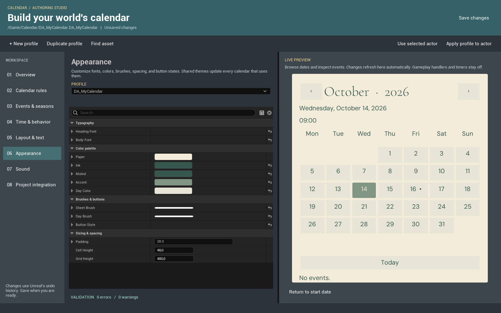

*Appearance contains your theme's fonts, brushes, colors, spacing, and sizes.*

Assign a **Calendar Theme** asset to replace the heading and body fonts, sheet and day brushes, button states, colors, padding, cell height, fixed grid height, and optional hover, click, confirmation, removal, notification, and rejection sounds. Brushes can use textures, materials, or sliced borders. Use a runtime composite Font asset. You can replace the supplied fonts with your own imported fonts through the normal font picker.

Open **Sound** to enable interface sounds for the profile and choose the theme's six sound cues. The editor preview stays silent; test sounds in Play.

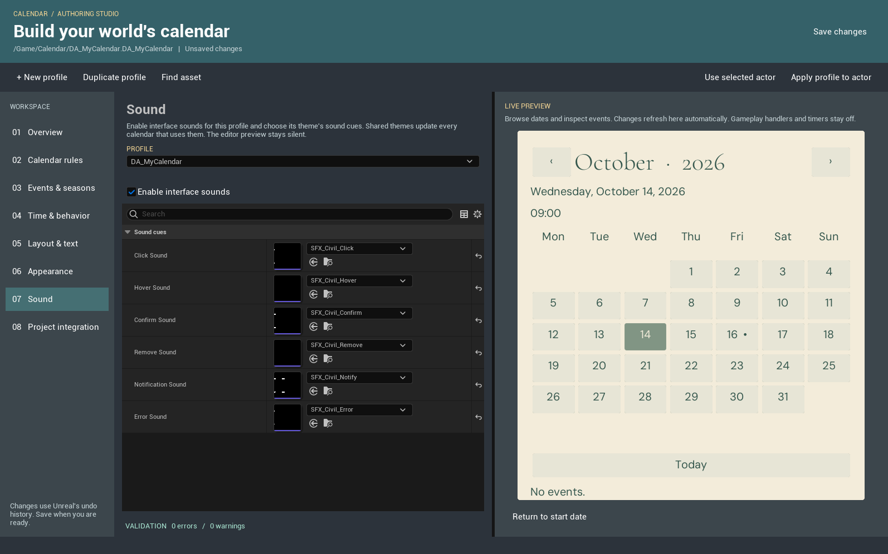

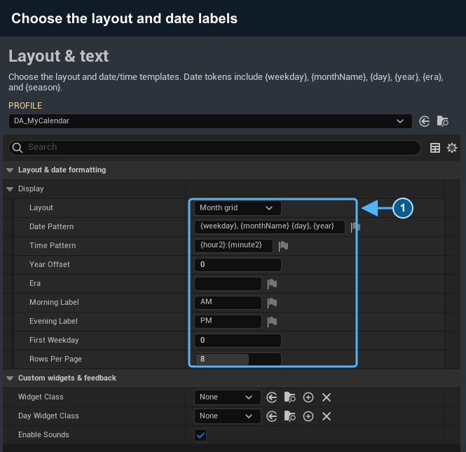

*Change presentation here; simulation dates keep their original meaning.*

**Display Settings > Layout** chooses **Month grid**, **Week planner**, or **Day list**. Week planner shows one week of date cards. Day list shows one date per row, with its event names. **Rows Per Page** sets the number of list dates or the maximum month rows. Choose a layout in the widget defaults or change it in Blueprint and call **Refresh Presentation**. You can keep your own day widgets and theme in every layout.

**Display Settings** also controls date and time templates, the displayed year offset and era, AM/PM labels, first weekday, and rows per page. Call **Refresh Presentation** after changing presentation settings. The simulation still uses its definition's ordered months, weekday cycle, clock subdivisions, year adjustments, and one-based year. A display offset can show year zero or another era without changing save data.

| Template | Example use |
|---|---|
| `{weekday}, {monthName} {day}, {year}` | Named date with your weekday and month labels |
| `{day2}/{month2}/{year} {era}` | Padded numeric date and era suffix |
| `{hour2}:{minute2}:{second2}` | Clock using the definition's subdivisions |
| `{hour12}:{minute2} {period}` | Twelve-hour clock for a 24-hour day |

Other tokens are `{month}`, `{season}`, `{hour}`, `{minute}`, and `{second}`. AM/PM is empty for clocks with a different number of hours. Invalid dates produce empty text. Displayed years use signed 64-bit numbers and saturate if an offset would overflow.

Set weekday **Short Name** for compact grid headings; the full name remains available in hover help. Weeks of up to 14 days align to their configured weekday cycle. Longer weeks use a continuous 14-column grid. Month pages contain at most 12 rows; page controls let you browse longer months. Day cells show up to eight matching event names, without running event handlers. Use **Get Events For Day** for a source-aware agenda that includes overlapping ranges. The native grid reserves its height across months, fills empty row cells, and shows paging controls only when needed. Clock-only changes update labels without rebuilding the day buttons or stealing focus. Selecting a day keeps it selected as time passes; **Today** follows the live date again.

To replace each day tile, make a Widget Blueprint with **Calendar Day Widget** as its parent and assign it to **Day Widget Class**. Its **View** supplies the date, today/selection highlights, and event names. Implement **On Cell Updated** to refresh your artwork. Optional designer widgets named `DayButton` and `DayLabel` receive native click and label updates. A custom click flow can call **Select Date** on the calendar sheet.

You can supply a complete designer layout in a Calendar Widget child. Optional controls named `Sheet`, `MonthTitle`, `DateLabel`, `TimeLabel`, `DetailLabel`, `DaysGrid`, `PreviousMonth`, `NextMonth`, `TodayButton`, `PreviousPage`, and `NextPage` receive native updates. With no designer tree, the native layout is created automatically. **On Presentation Changed** exposes a refresh hook for your own graphics. Keep replacement controls focusable for keyboard/gamepad navigation and large enough for touch.

The UI observes its supplied component in the same world. It is local presentation; it does not send client requests to change a replicated server calendar. Use your game's validated server request flow for time-changing controls.

### Add player controls

Your Player Controller owns input mode and focus. After adding the calendar to the screen, use **Set Input Mode Game and UI** and focus a day cell when using keyboard or gamepad navigation. Keep mouse controls clickable and touch targets large enough to tap.

The calendar sheet lets a player browse and select dates without changing game time. Your game's buttons can call **Try Advance**, **Start Auto Advance**, **Pause Auto Advance**, or **Reset to Start Date**. Bind those actions to mouse/keyboard, gamepad, and touch in your project. For a shared timeline, send permitted changes through your server request flow.

For a custom schedule interface, derive from **Calendar Event Editor Widget** or **Calendar Agenda Entry Widget**. Editor children receive **On Editor Ready** with their component and event view; call the component's validated schedule nodes, then **Close Editor**. Agenda children receive **View** and **On Entry Presented**; call **Select Entry** from your button. Built-in schedules are read-only in the player editor. Check authority before allowing changes.

## Authority and networking

Replication shares calendar date changes from the server to connected players. It is off by default. Without it, each Calendar Component is an independent local timeline.

For a shared timeline, use a server-owned replicated actor, enable replication on both the actor and Calendar Component, and assign the same installed definition assets to the participating builds. Definition, Current Date, and Created Events are replicated state. Server creation, edits, removals, and the current created schedule reach connected and late-joining clients. Date-change delegates can update each client's local display when new dates arrive.

Change the shared calendar, run automatic steps and scheduled events, add/edit/remove created entries, and create or restore snapshots on the server authority: the server that owns the shared calendar state. Calendar rejects those calls from players' replicated components. It does not send player requests to the server automatically. Use your game's server request flow and check which player may make each change.

Scheduled handlers and On Event Triggered execute on the authority. Client UI, timer lifecycle settings, and event-handler state do not become shared simply because Current Date is replicated. Replicate your own resulting gameplay state where needed. Keep local input and UI on their owning client.

> [!NOTE]
> Calendar 1.0 targets standalone games and listen servers, where a player also hosts the server. Dedicated-server deployments are outside its advertised support scope.

## Validation and troubleshooting

Use **Validate Calendar Definition** to obtain all definition issues, or **Validate Configuration** on the component to inspect its assigned rules and settings. Each issue includes a message, context, and suggested action.

| Symptom | Check |
|---|---|
| Calendar is not initialized | Assign a valid definition, enable Initialize on Begin Play, or call Initialize Calendar. |
| Date change is rejected | Check the operation result, valid date ranges, missing-day policy, and authority. |
| Timer does not advance | Initialize first, use a non-zero amount and valid interval, then start it. Check world pause and the last failure. |
| An event is missing | Check Enabled, its exact anchor, repeat interval, end-exclusive range, crossing setting, notification limit, and authority. |
| Snapshot cannot restore | Check schema, Definition ID, date validity, timer settings, and initialization. |
| Replicated calendar cannot initialize | Enable replication on its owner as well as the component, and initialize on the server. |

**Get Diagnostic Snapshot** returns current date, definition identity, initialization, timer, replication/authority, event-count, and last-operation state. Bind **On Operation Failed** for concise error feedback in your own tools. **Enable Debug Logging** is off by default. **Dump Diagnostics to Log** writes one bounded diagnostic entry and is a development-only node.

For support, include the operation result and a small reproducible case. Remove sensitive project information before sharing logs.

## Advanced Blueprint reference

Open the calculation nodes and data types

These utility nodes calculate or inspect values without changing a component's date:

| Node | Result |
|---|---|
| Is Calendar Date Valid | Test an exact date against the definition. |
| Try Advance Calendar Date | Calculate a destination using the chosen unit, amount, and missing-day policy. |
| Try Get Calendar Day Index | Convert a valid date to a zero-based whole-day index from `1/1/1`. |
| Try Get Elapsed Calendar Days | Signed difference between two day indices; time-of-day fields do not affect the difference. |
| Try Get Calendar Weekday | Resolve a weekday index and entry. |
| Does Calendar Event Occur | Match an event at an exact candidate date, without running its handler. |
| Format Calendar Date | Create display text using the definition's month names. Formatting does not validate the date. |

On the definition itself, **Get Days in Month**, **Validate Definition**, and **Is Date Valid** provide rule lookup and validation. Use the native Blueprint types **Calendar Date Time**, **Calendar Operation Result**, **Calendar Validation Report**, **Calendar Event Context**, **Calendar Save Snapshot**, and **Calendar Diagnostic Snapshot** to connect your logic.

## Support

[Try the free Windows demo](https://funbydefault.itch.io/calendar-demo). It does not include the plugin source or Calendar Editor.

Contact **FunByDefault** at [funbydefault.dev@gmail.com](mailto:funbydefault.dev@gmail.com). Include Calendar version, Unreal Engine version, platform, relevant operation result, and concise steps to reproduce the problem in a clean project. Do not send credentials or post private project files publicly.

[Report a reproducible problem](https://github.com/funbydefault/calendar-docs/issues) if you can share it publicly.

